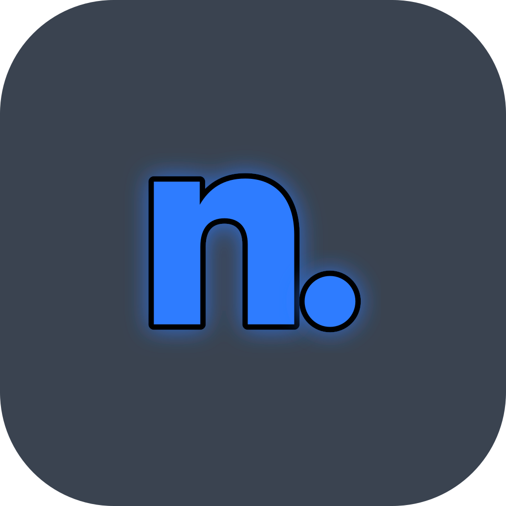

<h3 align="center">Science By Hugs</h3>

A research and technology company focused on health and wellness research. · <a href="https://sciencebyhugs.com"><strong>sciencebyhugs.com</strong></a>

---

## Products

| | Product | What it is | Link |
| --- | --- | --- | --- |
|  | **nexus** | Research supply store (verified researchers, local drop-off) | nexus.sciencebyhugs.com |
|  | **pulse** | Research tracking app (iPhone beta) | TestFlight |
|  | **core** | Internal operations, team only | core.sciencebyhugs.com |

## Site structure

Static site on GitHub Pages, deployed by `.github/workflows/pages.yml` on every push to `main`. No build step, no fonts or trackers loaded from other sites.

- `index.html` home, with a 21+ / research-use gate (remembered per browser)
- `privacy.html`, `terms.html`, `research-use.html`, `refunds.html`, `delivery.html`, `sms.html`, `cookies.html` policies (drafts, effective Nov 16 2026)
- `styles.css`, `script.js` (gate + service worker), `sw.js` (network-first cache; bump `CACHE_NAME` on big releases)
- `assets/` hugs. ring, favicon, app icons, product icons, social preview image

## Brand (hugs. rebrand, Nov 2026)

Slate `#0B0E13` · Slate 2 `#11161D` · Cloud `#E8ECF1` · Fog `#9AA4B2` · Reactor Blue `#3FB8FF`
nexus: Cobalt `#2F7BFF` on Nexus Slate `#3A4350` · core: Gold `#D4AF37` on Black · pulse: Pulse Blue on Midnight `#0B1424`
Lowercase product names, no taglines, system font on the web.

## Handoff

**Done (Nov 15 2026):** full rebrand to hugs.; new home page (products, how it works, About, research-use notice, contact); six policy pages from the draft policy doc; new icons and manifest; service worker cache bumped to `sbh-hub-v7-hugs` so returning visitors get the new site; dropped Google Fonts.

**Before merging to main:**
1. Attorney review of the policies, then remove the "Draft — under legal review" badges.
2. Fill the remaining placeholders: `[X]` business days (research-use), `[X–Y]` days and drop-off fee (delivery). Address and effective dates are done.
3. About (version B) and pulse line are final.
4. Check the live site on an iPhone in Safari after deploy (the service worker should swap the old site out on first or second load).

**Next:** set up the Text Messaging opt-in checkbox in nexus sign-up and checkout to match `sms.html`.
